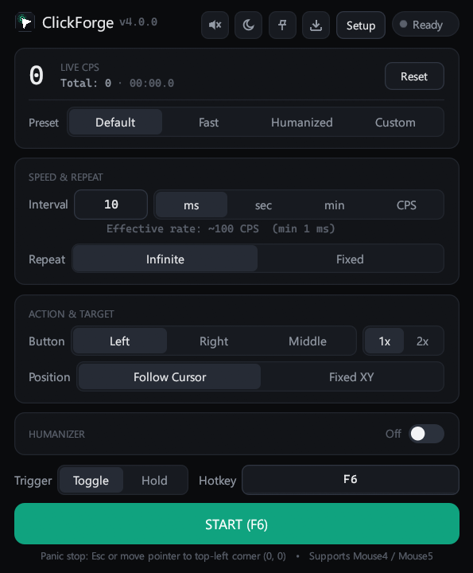
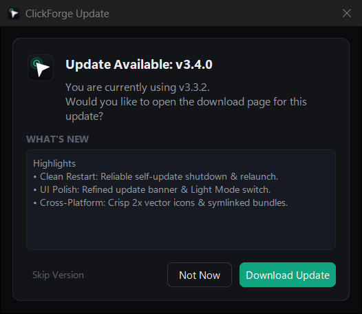

<div align="center">


# Klick

**High-precision, lightweight native desktop auto-clicker for Windows, macOS, and Linux (Wayland / Hyprland & X11).**

Built in pure **Rust** with `egui` / `eframe`, native OS input APIs (`SendInput`, CoreGraphics, `/dev/uinput` + Hyprland IPC, X11 XTest), 1 ms multimedia timing (`timeBeginPeriod`), and a utilitarian **Carbon & Precision Emerald** palette.

[](https://github.com/efeartn/Klick/releases/latest)
[](LICENSE)
[-52525B)](#download--install)
[](CHANGELOG.md)

[](https://github.com/efeartn/Klick/releases/latest/download/Klick-Setup.exe)
&nbsp;
[](https://github.com/efeartn/Klick/releases/latest)

</div>

---

## Screenshots

<table>
  <tr>
    <td align="center" width="50%">
      <strong>Carbon Dark Mode</strong><br/><br/>
      
    </td>
    <td align="center" width="50%">
      <strong>Carbon Light Mode</strong><br/><br/>
      
    </td>
  </tr>
  <tr>
    <td align="center" width="50%">
      <strong>Windows Programs Setup</strong><br/><br/>
      
    </td>
    <td align="center" width="50%">
      <strong>Automatic Update Prompt</strong><br/><br/>
      
    </td>
  </tr>
</table>

---

## Pure Native Performance (`v1.0.0`)

Formerly **ClickForge** — renamed to **Klick** with automatic config migration from `%LOCALAPPDATA%\ClickForge\config.json` (and `~/.config/ClickForge/config.json`). Built in **Rust** for instant startup, minimal footprint, and deterministic click timing across Windows, macOS, and Linux:

- **Single Native Executable:** Ships as a standalone **`~5 MB`** binary with zero runtime dependencies or temporary extraction delays.
- **Instant Launch & Low Overhead:** Opens cleanly in under **`200 ms`**, relaxes repaints when settled, and draws crisp procedural vector header icons directly via GPU shaders.
- **Adaptive Workspace & AltSnap Ready:** Inactive sections (`Fixed XY`, fixed repeat count, and `Humanizer` fields) collapse cleanly while keeping a standard resizable Win32 frame (`WS_THICKFRAME`) that works seamlessly with **AltSnap** and OS window snapping.
- **Follow Cursor & `10 ms` Default:** Ready immediately on launch to click at your pointer (`10 ms` / `~100 CPS`), scaling from `1 click/hour` up to **`1,000 CPS`** (`1 ms` interval).
- **Zero-Delay Global Triggers & `Esc` Panic:** Press **`F6`** (`Toggle` or `Hold`), bind **Mouse4 / Mouse5** or Numpad keys via the keycap button, or press **`Esc`** / fling pointer to `(0, 0)` to stop immediately—even from fullscreen apps.

---

## Download & Install

| Platform | Package | Notes |
| --- | --- | --- |
| **Windows (Installer)** | [`Klick-Setup.exe`](https://github.com/efeartn/Klick/releases/latest/download/Klick-Setup.exe) | **Recommended.** Installs to `%LOCALAPPDATA%\Programs\Klick`, registers Start Menu & Windows Installed Apps without admin UAC prompts, and enables automatic self-updates. |
| **Windows (Portable)** | [`Klick-Windows.zip`](https://github.com/efeartn/Klick/releases/latest/download/Klick-Windows.zip) | Extract and run `Klick.exe`. Includes a **Setup** button in the header to install into Windows Programs anytime. |
| **macOS** | [`Klick-macOS.zip`](https://github.com/efeartn/Klick/releases/latest/download/Klick-macOS.zip) | Unzip `Klick.app`. Grant **Accessibility** access under *System Settings → Privacy & Security* for global hotkeys and mouse injection. |
| **Linux (Wayland / Hyprland & X11)** | [`Klick-Linux.zip`](https://github.com/efeartn/Klick/releases/latest/download/Klick-Linux.zip) | Unzip and run `./Klick`. Works natively on **Hyprland / Wayland** (see one-time permissions below) and **X11 / Xorg** out of the box. |

### Quick Start

1. Download the release package for your OS above.
2. Launch **Klick** (`Follow Cursor`, `10 ms` / `~100 CPS`, and `F6` work immediately).
3. Press **`F6`** (or click **START**) to begin; press **`Esc`** or move the cursor to `(0, 0)` to panic-stop anytime.

### Linux Wayland & Hyprland Setup

Wayland isolates display clients from reading global keys or injecting synthetic clicks directly, so Klick uses Linux kernel `/dev/uinput` + `evdev` (plus direct **Hyprland socket IPC** for multi-monitor bounds and exact `Fixed XY` cursor moves):

1. Grant your user permission to read input events (`evdev` global hotkeys) and create a virtual mouse (`/dev/uinput` clicks):
   ```bash
   sudo usermod -aG input "$USER"
   echo 'KERNEL=="uinput", GROUP="input", MODE="0660"' | sudo tee /etc/udev/rules.d/99-klick.rules
   sudo udevadm control --reload-rules && sudo udevadm trigger /dev/uinput
   ```
2. Log out and log back into your session so group membership takes effect.

| Linux Backend | Clicks | Hotkeys (`Keyboard` & `Mouse4/5`) | `Fixed XY` Positioning | Notes |
| --- | --- | --- | --- | --- |
| **Hyprland (Wayland)** | `/dev/uinput` | `/dev/input/event*` | Hyprland IPC (`movecursor` + `j/monitors`) | Multi-monitor + corner failsafe supported |
| **Other Wayland** *(Sway, GNOME, KDE)* | `/dev/uinput` | `/dev/input/event*` | Virtual absolute pointer (`ABS_X/Y`) | Includes zero-drift relative Humanizer spread |
| **X11 / Xorg** | `XTest` (`x11rb`) | `RECORD` extension | Native root coordinates | Works immediately with no setup |

---

## Presets & Engine Architecture

### Built-in Presets

| Preset | Rate | Position Target | Click Type & Repeat | Humanizer |
| --- | --- | --- | --- | --- |
| **Default** | `10 ms` (`~100 CPS`) | `Follow Cursor` | `Left · 1x · Infinite` | Off |
| **Fast** | `500 CPS` | Keeps current mode | `Left · 1x · Infinite` | Off |
| **Humanized** | `12 CPS` | Keeps current mode | `Left · 1x · Infinite` | `±15 % σ` jitter, `18–42 ms` hold duty, `±2 px` spread |
| **Custom** | User-defined (`ms` / `sec` / `min` / `CPS`) | `Follow Cursor` or `Fixed XY` | `Left` / `Right` / `Middle` · `1x` / `2x` · `Infinite` / `Fixed` | Optional |

### Precision Timing & Cross-Platform Backends
- **Windows:** Pre-built Win32 `SendInput` structs, RAII `timeBeginPeriod(1)` 1 ms multimedia timer, and low-level `WH_KEYBOARD_LL` + on-demand `WH_MOUSE_LL` (`Mouse4`/`Mouse5`) hooks.
- **macOS:** Direct CoreGraphics (`CGEventCreateMouseEvent`, `CGEventPost`, `CGEventTapCreate`) with multi-monitor `CGDisplayBounds`.
- **Linux:** Automatic runtime selection between native Wayland (`uinput` + `evdev` + Hyprland IPC) and X11 (`XTest` + `RECORD`).
- **Guaranteed Button Release:** Stopping mid-hold, pressing `Esc`, or exiting always emits `mouseUp` so buttons never stick.
- **Anchored Humanizer Spread:** Gaussian interval jitter, triangular hold duty, and zero-drift disk **Spread (`± px`)** work in both **Follow Cursor** (even via relative deltas on Wayland) and **Fixed XY**.
- **Verified In-App Auto-Updater:** Checks GitHub Releases via `ureq` + `rustls`, displays `"What's New"` release notes, verifies byte size + **`SHA-256`** digest, and applies rollback-safe Windows updates automatically.

---

## Build from Source

Requires the **Rust stable toolchain** ([rustup.rs](https://rustup.rs/)).

```bash
git clone https://github.com/efeartn/Klick.git
cd Klick
cargo run --release
```

On Debian/Ubuntu Linux, install the X11 & OpenGL development headers first:

```bash
sudo apt-get install -y libgl1-mesa-dev libegl1-mesa-dev libx11-dev libxkbcommon-dev libxkbcommon-x11-dev libxcb-shape0-dev libxcb-xfixes0-dev libwayland-dev
```

Run unit tests and headless CLI checks:

```bash
cargo test
cargo run --release -- --smoke-test
```

---

## Project Layout

```text
Klick/
├── src/
│   ├── main.rs                 # Entrypoint, CLI (--version / --smoke-test), eframe setup
│   ├── meta.rs                 # App name, version (1.0.0), embedded icon
│   ├── core/
│   │   ├── clicker.rs          # Lock-free telemetry, Humanizer worker, corner failsafe
│   │   ├── config.rs           # Schema-validated persistent config & profile presets
│   │   ├── hotkeys.rs          # Global triggers (Win32 / macOS / evdev / X11 Record)
│   │   ├── input_backend.rs    # Mouse injection (SendInput / CoreGraphics / uinput / XTest)
│   │   ├── wayland.rs          # Linux Wayland uinput, evdev reader & Hyprland socket IPC
│   │   ├── installer.rs        # Windows Programs & Start Menu installer integration
│   │   ├── sound.rs            # Non-blocking start/stop chimes
│   │   ├── system.rs           # Multi-monitor bounds, permission checks, cleanup
│   │   ├── timing.rs           # RAII 1 ms timer guard & precision wait primitives
│   │   ├── updater.rs          # GitHub Releases updater with SHA-256 & rollback
│   │   └── validation.rs       # Numeric filters and speed/unit conversions
│   └── ui/
│       ├── app.rs              # Adaptive main window, banners & Carbon modals
│       ├── icons.rs            # Procedural vector header icons
│       ├── picker.rs           # Full-desktop transparent crosshair coordinate picker
│       ├── theme.rs            # Carbon & Precision Emerald dark/light tokens & fonts
│       └── widgets.rs          # Segmented pills, keycap button, toggle switch, numeric fields
├── assets/                     # App icons (.ico, .icns, .png, .svg)
├── docs/screenshots/           # Dark, light, Windows setup, and updater previews
├── installer/Klick.iss         # Inno Setup 6 script for Klick-Setup.exe
├── Cargo.toml                  # Crate manifest and release optimization profile
├── build.rs                    # Windows resource & icon embedding
├── CHANGELOG.md
└── CONTRIBUTING.md
```

---

## License

Licensed under the [GNU General Public License v3.0](LICENSE).
