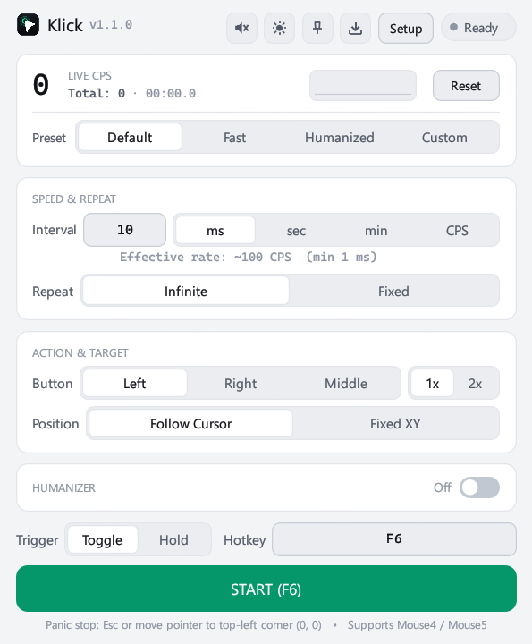
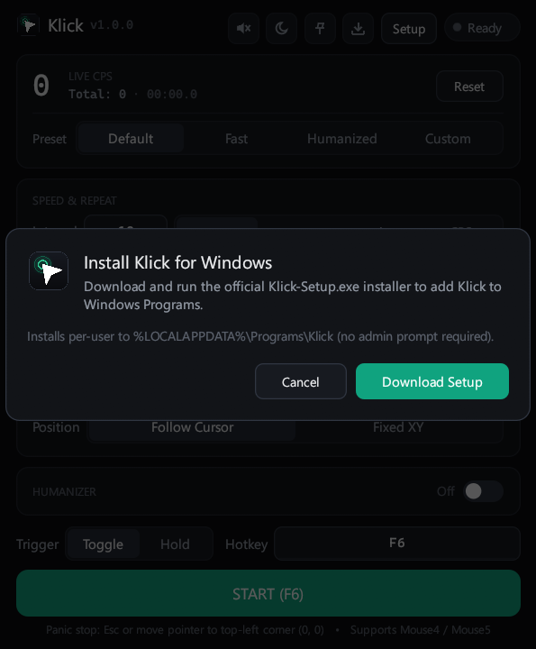

<div align="center">


# ClickForge

**High-precision, lightweight native desktop auto-clicker for Windows, macOS, and Linux.**

Built in pure **Rust** with `egui` / `eframe`, native OS input APIs (`SendInput`, CoreGraphics, XTest), 1 ms multimedia timing (`timeBeginPeriod`), and a utilitarian **Carbon & Precision Emerald** palette.

[](https://github.com/efeartn/ClickForge/releases/latest)
[](LICENSE)
[](#download--install)
[](CHANGELOG.md)

[](https://github.com/efeartn/ClickForge/releases/latest/download/ClickForge-Setup.exe)
&nbsp;
[](https://github.com/efeartn/ClickForge/releases/latest)

</div>

---

## Screenshots

<table>
  <tr>
    <td align="center" width="50%">
      <strong>Carbon Dark Mode</strong><br/><br/>
      
    </td>
    <td align="center" width="50%">
      <strong>Carbon Light Mode</strong><br/><br/>
      
    </td>
  </tr>
  <tr>
    <td align="center" width="50%">
      <strong>Windows Programs Setup</strong><br/><br/>
      
    </td>
    <td align="center" width="50%">
      <strong>Automatic Update Prompt</strong><br/><br/>
      
    </td>
  </tr>
</table>

---

## Pure Native Performance (`v4.0.0 — "Ferrous"`)

Rewritten from the ground up in **Rust** for instant startup, minimal footprint, and deterministic click timing:

- **Single Native Executable:** Ships as a standalone **`4.97 MB`** Windows executable with zero runtime dependencies or temporary bundle extraction.
- **Instant Launch & Low Overhead:** Opens directly in **`~172 ms`**, pauses repaints down to idle cadence when settled, and draws crisp procedural vector header icons directly via GPU shaders.
- **Adaptive & Compact Workspace:** Inactive sections (`Fixed XY` coordinates while following cursor, fixed repeat count in `Infinite` mode, and `Humanizer` fields while disabled) collapse automatically to keep the window compact on any display.
- **Follow Cursor & `10 ms` Default:** Starts ready to click where your pointer is at `10 ms` (`~100 CPS`), scaling from `1 click/hour` up to **`1,000 CPS`** (`1 ms` interval).
- **Working `F6` Trigger & `Esc` Panic:** Press **`F6`** immediately on launch (`Toggle` or `Hold`), bind **Mouse4 / Mouse5** or Numpad keys via the keycap control, or press **`Esc`** / fling the pointer to `(0, 0)` for instant emergency stop.

---

## Download & Install

| Platform | Package | Notes |
| --- | --- | --- |
| **Windows (Installer)** | [`ClickForge-Setup.exe`](https://github.com/efeartn/ClickForge/releases/latest/download/ClickForge-Setup.exe) | **Recommended.** Installs to `%LOCALAPPDATA%\Programs\ClickForge`, adds Start Menu shortcuts & Windows Installed Apps entry with no UAC/admin prompt, and enables automatic self-updates. |
| **Windows (Portable)** | [`ClickForge-Windows.zip`](https://github.com/efeartn/ClickForge/releases/latest/download/ClickForge-Windows.zip) | Extract and run `ClickForge.exe`. Includes a **Setup** button in the header to install into Windows Programs anytime. |
| **macOS** | [`ClickForge-macOS.zip`](https://github.com/efeartn/ClickForge/releases/latest/download/ClickForge-macOS.zip) | Unzip `ClickForge.app`. Grant **Accessibility** access under *System Settings → Privacy & Security* so global hotkeys and mouse injection work. |
| **Linux (X11)** | [`ClickForge-Linux.zip`](https://github.com/efeartn/ClickForge/releases/latest/download/ClickForge-Linux.zip) | Unzip and run `./ClickForge`. Requires an X11 session for XTest injection and X11 Record global hotkeys. |

### Quick Start

1. Run [`ClickForge-Setup.exe`](https://github.com/efeartn/ClickForge/releases/latest/download/ClickForge-Setup.exe) (if Windows SmartScreen prompts on an unsigned release, click **More info → Run anyway**).
2. Launch **ClickForge** from the Start Menu (`Follow Cursor`, `10 ms` / `~100 CPS`, and `F6` are ready immediately).
3. Press **`F6`** (or click **START**) to start/stop clicking; press **`Esc`** or move the cursor to `(0, 0)` to panic-stop anytime.

---

## Presets & Engine Architecture

### Built-in Presets

| Preset | Rate | Position Target | Click Type & Repeat | Humanizer |
| --- | --- | --- | --- | --- |
| **Default** | `10 ms` (`~100 CPS`) | `Follow Cursor` | `Left · 1x · Infinite` | Off |
| **Fast** | `500 CPS` | Keeps current mode | `Left · 1x · Infinite` | Off |
| **Humanized** | `12 CPS` | Keeps current mode | `Left · 1x · Infinite` | `±15 % σ` jitter, `18–42 ms` hold duty, `±2 px` spread |
| **Custom** | User-defined (`ms` / `sec` / `min` / `CPS`) | `Follow Cursor` or `Fixed XY` | `Left` / `Right` / `Middle` · `1x` / `2x` · `Infinite` / `Fixed` | Optional |

### Precision Timing & Cross-Platform Backends
- **Windows `SendInput` & `timeBeginPeriod(1)`:** Acquires 1 ms OS timer resolution via an RAII guard while running, pairing `Condvar::wait_timeout` with a final spin window to sustain up to **`1,000 CPS`**.
- **macOS & Linux Native Backends:** Uses CoreGraphics (`CGEventCreateMouseEvent` / `CGEventTapCreate`) on macOS and `x11rb` (`xtest` + `record`) on Linux X11 with zero external runtime dependencies.
- **Guaranteed Button Release:** Stopping mid-hold or exiting mid-run always emits `mouseUp` so buttons never stick.
- **Anchored Humanizer Spread:** Uniform-disk coordinate **Spread (`± px`)** works in both **Follow Cursor** and **Fixed XY** without cumulative cursor drift.
- **Verified In-App Auto-Updater:** Checks GitHub Releases via `ureq` + `rustls`, displays formatted `"What's New"` release notes, verifies byte size + **`SHA-256`** digest, and safely swaps Windows builds with `.cfbak` rollback.

---

## Build from Source

Requires the **Rust stable toolchain** ([rustup.rs](https://rustup.rs/)).

```bash
git clone https://github.com/efeartn/ClickForge.git
cd ClickForge
cargo run --release
```

On Debian/Ubuntu Linux, install the X11 & OpenGL development headers first:

```bash
sudo apt-get install -y libgl1-mesa-dev libegl1-mesa-dev libx11-dev libxkbcommon-dev libxkbcommon-x11-dev libxcb-shape0-dev libxcb-xfixes0-dev libwayland-dev
```

Run tests and smoke checks:

```bash
cargo test
cargo run --release -- --smoke-test
```

---

## Project Layout

```text
ClickForge/
├── src/
│   ├── main.rs                 # Entrypoint, CLI (--version / --smoke-test), eframe setup
│   ├── meta.rs                 # App name, version (4.0.0), codename (Ferrous), embedded icon
│   ├── core/
│   │   ├── clicker.rs          # Lock-free telemetry, Humanizer worker, corner failsafe
│   │   ├── config.rs           # Schema-validated persistent config & profile presets
│   │   ├── hotkeys.rs          # Global keyboard & Mouse4/5 listeners (Win32 / macOS / X11)
│   │   ├── input_backend.rs    # Native mouse injection (SendInput / CoreGraphics / XTest)
│   │   ├── installer.rs        # Windows Programs & Start Menu installer integration
│   │   ├── sound.rs            # Non-blocking start/stop chimes
│   │   ├── system.rs           # Multi-monitor bounds, permission checks, cleanup
│   │   ├── timing.rs           # RAII 1 ms timer guard & precision wait primitives
│   │   ├── updater.rs          # GitHub Releases updater with SHA-256 & rollback
│   │   └── validation.rs       # Numeric filters and speed/unit conversions
│   └── ui/
│       ├── app.rs              # Adaptive main window, banners & Carbon modals
│       ├── icons.rs            # Procedural vector header icons
│       ├── picker.rs           # Full-desktop transparent crosshair coordinate picker
│       ├── theme.rs            # Carbon & Precision Emerald dark/light tokens & fonts
│       └── widgets.rs          # Segmented pills, keycap button, toggle switch, numeric fields
├── assets/                     # App icons (.ico, .icns, .png, .svg)
├── docs/screenshots/           # Dark, light, Windows setup, and updater previews
├── installer/ClickForge.iss    # Inno Setup 6 script for ClickForge-Setup.exe
├── Cargo.toml                  # Crate manifest and release optimization profile
├── build.rs                    # Windows resource & icon embedding
├── CHANGELOG.md
└── CONTRIBUTING.md
```

---

## License

Licensed under the [GNU General Public License v3.0](LICENSE).
