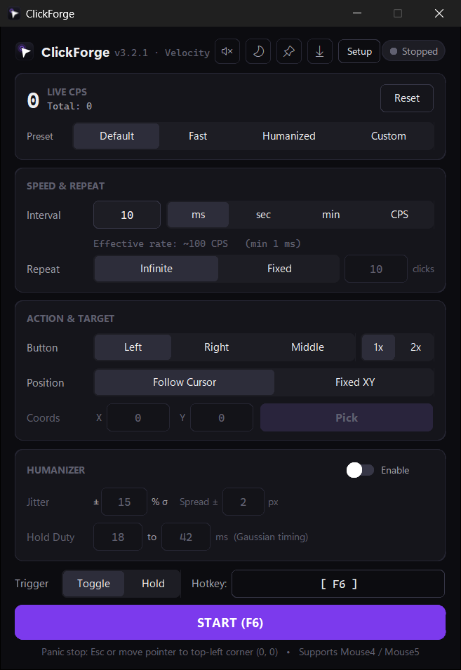
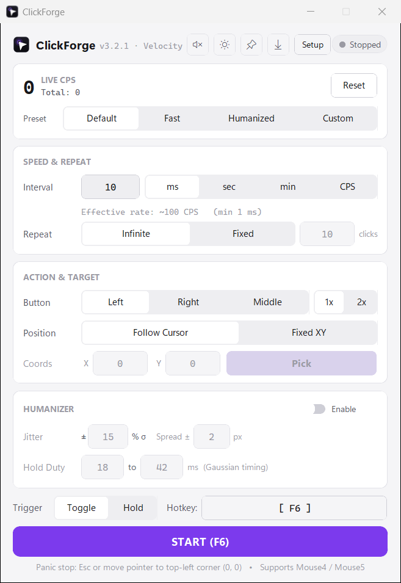
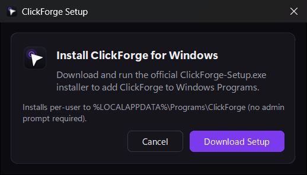

<div align="center">


# ClickForge

**High-precision, modern desktop auto-clicker for Windows, macOS, and Linux.**

Built with CustomTkinter, Win32 `SendInput`, 1 ms multimedia timing (`timeBeginPeriod`), and an Obsidian & Porcelain UI palette.

[](https://github.com/efeartn/ClickForge/releases/latest)
[](LICENSE)
[](#download--install)
[](CHANGELOG.md)

[](https://github.com/efeartn/ClickForge/releases/latest/download/ClickForge-Setup.exe)
&nbsp;
[](https://github.com/efeartn/ClickForge/releases/latest)

</div>

---

## Screenshots

<table>
  <tr>
    <td align="center" width="50%">
      <strong>Unified Workspace — Dark Mode</strong><br/><br/>
      
    </td>
    <td align="center" width="50%">
      <strong>Unified Workspace — Light Mode</strong><br/><br/>
      
    </td>
  </tr>
  <tr>
    <td align="center" width="50%">
      <strong>Windows Programs Setup</strong><br/><br/>
      
    </td>
    <td align="center" width="50%">
      <strong>Automatic Update Prompt</strong><br/><br/>
      
    </td>
  </tr>
</table>

---

## Ready Out of the Box

ClickForge opens directly into one unified workspace with ready-to-use defaults:

- **Follow Cursor by Default:** Clicks land wherever your pointer is immediately on launch (switch to **Fixed XY** + multi-monitor **Pick** anytime).
- **`10 ms` (`~100 CPS`) Default Speed:** Snappy out of the box, scalable from 1 click/hour up to **`1,000 CPS`** (`1 ms` interval).
- **Working `F6` Trigger & `Esc` Panic:** Press **`F6`** immediately on launch to start/stop (`Toggle` or `Hold`), bind **Mouse4 / Mouse5** or Numpad keys, or hit **`Esc`** / fling pointer to `(0, 0)` for instant emergency stop.
- **Fast Startup (~1.2 s):** Folder-based distribution (`_internal/`), single-pass layout construction, and cached icons launch cleanly without single-file extraction delays.

---

## Download & Install

| Platform | Package | Notes |
| --- | --- | --- |
| **Windows (Installer)** | [`ClickForge-Setup.exe`](https://github.com/efeartn/ClickForge/releases/latest/download/ClickForge-Setup.exe) | **Recommended.** Installs to `%LOCALAPPDATA%\Programs\ClickForge`, adds Start Menu shortcuts & Windows Installed Apps entry with no UAC/admin prompt, and enables automatic self-updates. |
| **Windows (Portable)** | [`ClickForge-Windows.zip`](https://github.com/efeartn/ClickForge/releases/latest/download/ClickForge-Windows.zip) | Extract and run `ClickForge.exe`. Includes a **Setup** button in the header to install into Windows Programs anytime. |
| **macOS** | [`ClickForge-macOS.zip`](https://github.com/efeartn/ClickForge/releases/latest/download/ClickForge-macOS.zip) | Unzip `ClickForge.app`. Grant **Accessibility** access under *System Settings → Privacy & Security* so global hotkeys and mouse injection work. |
| **Linux (X11)** | [`ClickForge-Linux.zip`](https://github.com/efeartn/ClickForge/releases/latest/download/ClickForge-Linux.zip) | Unzip and run `./ClickForge`. Requires an X11 session for global keyboard/mouse hooks. |

### Quick Start

1. Run [`ClickForge-Setup.exe`](https://github.com/efeartn/ClickForge/releases/latest/download/ClickForge-Setup.exe) (if Windows SmartScreen prompts on an unsigned release, click **More info → Run anyway**).
2. Launch **ClickForge** from the Start Menu (`Follow Cursor`, `10 ms` / `~100 CPS`, and `F6` are ready immediately).
3. Press **`F6`** (or click **START**) to start/stop clicking; press **`Esc`** or move the cursor to the top-left corner `(0, 0)` to panic-stop anytime.

---

## Presets & Features

### Built-in Presets

| Preset | Rate | Position Target | Click Type & Repeat | Humanizer |
| --- | --- | --- | --- | --- |
| **Default** | `10 ms` (`~100 CPS`) | `Follow Cursor` | `Left · 1x · Infinite` | Off |
| **Fast** | `500 CPS` | Keeps current mode | `Left · 1x · Infinite` | Off |
| **Humanized** | `12 CPS` | Keeps current mode | `Left · 1x · Infinite` | `±15 % σ` jitter, `18–42 ms` hold duty, `±2 px` spread |
| **Custom** | User-defined (`ms` / `sec` / `min` / `CPS`) | `Follow Cursor` or `Fixed XY` | `Left` / `Right` / `Middle` · `1x` / `2x` · `Infinite` / `Fixed` | Optional |

### Precision & High-CPS Engine
- **Windows `SendInput` Fast Path:** Pre-allocated `ctypes` `INPUT` structures avoid per-click allocation overhead, sustaining up to **`1,000 CPS`**.
- **Sub-Millisecond Scheduler (`timing.py`):** Acquires `timeBeginPeriod(1)` only while clicking is active and pairs interruptible `Event.wait` with a light final spin (`1.5 ms` threshold).
- **Thread-Safe Guaranteed Release:** Stopping mid-hold or closing during a run always emits `mouseUp` so mouse buttons never remain stuck.
- **Live Telemetry & Persistent Config:** Real-time rolling 1-second **Live CPS** readout, total click counter, and schema-validated JSON settings stored per user via `platformdirs`.

### Desktop Ergonomics & Auto-Updater
- **Windows Setup Integration:** Official `ClickForge-Setup.exe` wizard plus an in-app **Setup** button when running uninstalled on Windows.
- **Automatic Startup Update Check:** Checks GitHub Releases on launch, previews `"What's New"` release notes, verifies download byte size + **`SHA-256`** digest, and installs rollback-safe updates automatically on frozen Windows builds (opens the release page on macOS, Linux, or source runs).
- **Header Quick Controls:** Toggle **Sound** start/stop chimes, cycle **System / Dark / Light** theme, toggle **Always-on-Top**, or manually check for updates.

---

## Run from Source

Requires **Python 3.9+** (CI verified on **Python 3.11**; local development tested up to **3.13**).

```bash
git clone https://github.com/efeartn/ClickForge.git
cd ClickForge
pip install -r requirements.txt
python main.py
```

Run tests:

```bash
python -m unittest discover -v tests
```

Build release bundle (`ClickForge-Windows.zip` and, with Inno Setup 6, `ClickForge-Setup.exe`):

```bash
python build.py --zip --installer
```

---

## Architecture

```text
ClickForge/
├── clickforge/
│   ├── __init__.py             # App name, version, and release codename
│   ├── __main__.py             # Module entrypoint (`python -m clickforge`)
│   ├── app.py                  # Window launch entrypoint
│   ├── core/
│   │   ├── clicker.py          # Worker thread engine, Humanizer, corner failsafe
│   │   ├── config.py           # Schema-validated persistent config & profile presets
│   │   ├── hotkeys.py          # Global keyboard & Mouse4/5 listener with VK normalization
│   │   ├── input_backend.py    # Win32 SendInput backend + pynput fallback
│   │   ├── installer.py        # Windows Programs & Start Menu installer helpers
│   │   ├── sound.py            # Non-blocking start/stop chimes
│   │   ├── system.py           # DPI awareness, multi-monitor bounds, asset paths
│   │   ├── timing.py           # HighResolutionTimer + precision wait_until
│   │   ├── updater.py          # GitHub Releases updater with SHA-256 & rollback
│   │   └── validation.py       # Numeric parsing and speed/unit conversions
│   └── ui/
│       ├── main_window.py      # Primary application window & event poll loop
│       ├── picker.py           # Multi-monitor fixed XY coordinate picker overlay
│       ├── theme.py            # Light/Dark Obsidian & Porcelain palette tokens
│       └── widgets.py          # Reusable cards, segmented pills, modal dialogs
├── docs/
│   └── screenshots/            # Dark, light, Windows setup, and updater previews
├── installer/
│   └── ClickForge.iss          # Inno Setup 6 script for ClickForge-Setup.exe
├── scripts/
│   └── generate_assets.py      # Vector-rendered app icons (.ico, .icns, .png, .svg)
├── tests/
│   └── test_clickforge.py      # Unit & UI test suite
├── CHANGELOG.md
├── CONTRIBUTING.md
└── pyproject.toml
```

---

## License

Licensed under the [GNU General Public License v3.0](LICENSE).
