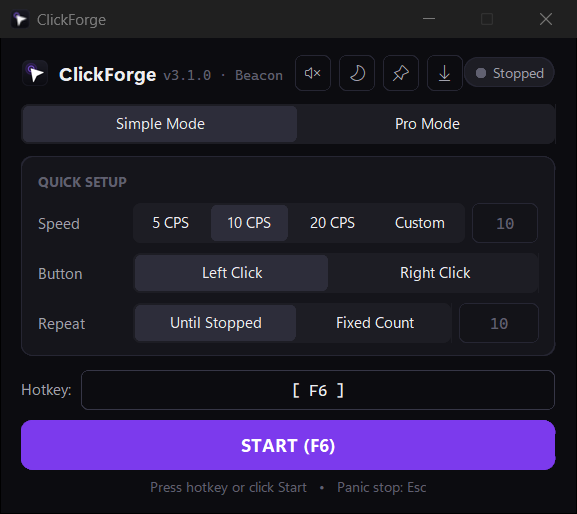
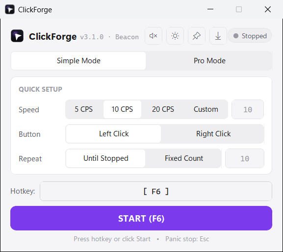
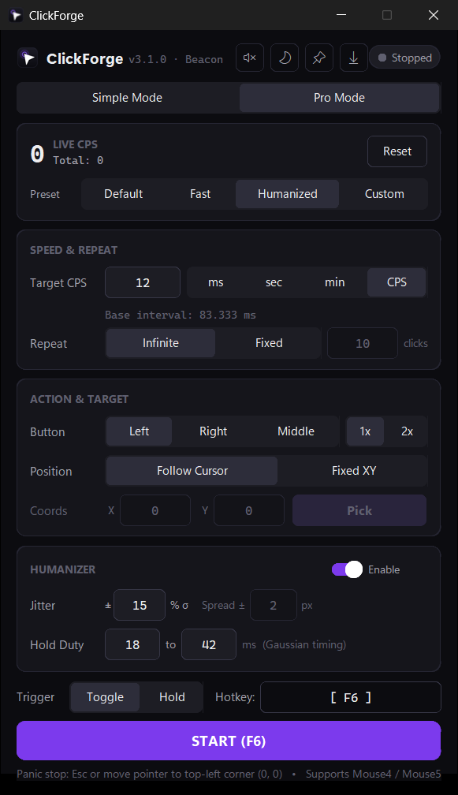
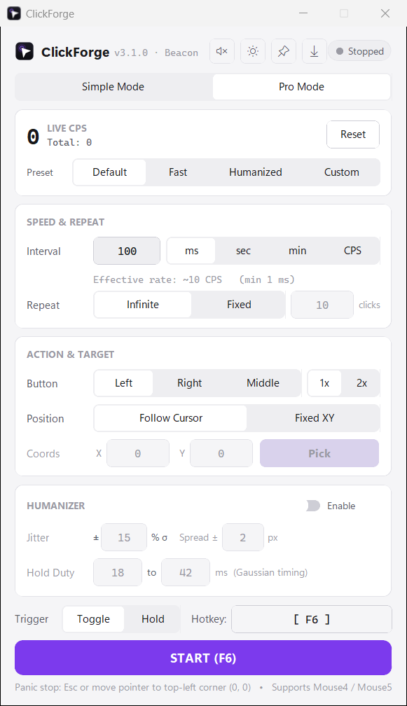
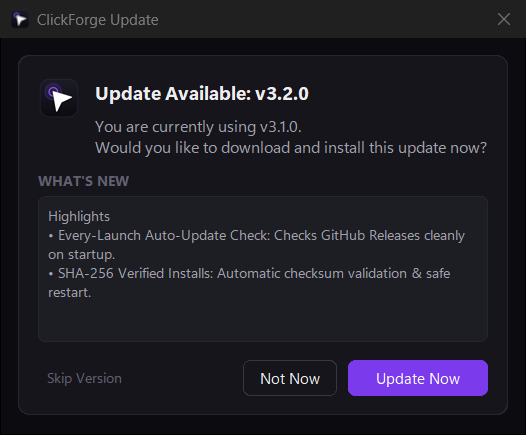

<div align="center">
  

  # ClickForge

  **Minimalist desktop auto-clicker engineered for sub-millisecond timing, native Win32 input injection, and effortless Simple & Pro workflows.**

  [](https://github.com/efeartn/ClickForge/releases/latest)
  [](https://github.com/efeartn/ClickForge/actions/workflows/build.yml)
  [](LICENSE)
  [](#installation)
  [](https://www.python.org/downloads/)

  [Download Latest](https://github.com/efeartn/ClickForge/releases/latest) · [Screenshots](#screenshots) · [Features](#features) · [Usage](#usage) · [Build from Source](#build-from-source) · [Changelog](CHANGELOG.md)
</div>

---

ClickForge pairs an Apple-inspired, clutter-free interface with a low-level click engine. On Windows, it bypasses high-level GUI wrappers and talks directly to `user32.SendInput` with pre-allocated C structures and a hybrid sleep + spin-wait timer loop—staying lightweight, predictable, and easy to use whether you just want `10 CPS` in two clicks or Gaussian-humanized automation.

---

## Screenshots

### Simple Mode — Clean & Frictionless
Designed for everyday users with zero clutter: quick CPS pills, Left/Right selection, clean repeat controls, and automatic content-fit window sizing in both Dark and Light themes.

<table>
  <tr>
    <td align="center" width="50%">
      <br>
      <sub><b>Simple Mode · Dark Theme</b></sub>
    </td>
    <td align="center" width="50%">
      <br>
      <sub><b>Simple Mode · Light Theme</b></sub>
    </td>
  </tr>
</table>

### Pro Mode — Full Power-User Suite
Switch to **Pro Mode** in one click for live rolling CPS telemetry, sub-millisecond custom intervals (`ms`, `sec`, `min`, `CPS`), a full-desktop XY crosshair picker, preset profiles, and the **Gaussian Humanizer**.

<table>
  <tr>
    <td align="center" width="50%">
      <br>
      <sub><b>Pro Mode · Dark Theme (Humanizer Active)</b></sub>
    </td>
    <td align="center" width="50%">
      <br>
      <sub><b>Pro Mode · Light Theme</b></sub>
    </td>
  </tr>
</table>

### Every-Launch Auto-Updater
ClickForge automatically checks GitHub Releases on startup and prompts clearly when a new version is ready—complete with release highlights and SHA-256 verified Windows self-updates.

<div align="center">
  <br>
  <sub><b>Startup Update Prompt · What's New &amp; One-Click Install</b></sub>
</div>

---

## Features

### Dual Interface (Simple & Pro)
- **Simple Mode:** Frictionless setup with `5 CPS`, `10 CPS`, `20 CPS`, and `Custom` pills, **Left / Right** mouse button choice, and **Until Stopped / Fixed Count** repeat options.
- **Pro Mode:** Full advanced panel with multi-unit intervals (`ms`, `sec`, `min`, `CPS`), **1x / 2x** clicks, **Follow Cursor / Fixed XY** positioning, preset profiles (`Default`, `Fast`, `Humanized`, `Custom`), and live rolling 1-second CPS telemetry.
- **Adaptive Dark & Light Themes:** Automatic OS theme matching with instant light/dark/system cycling and an **Always-on-Top** header pin.

### Precision Engine & Failsafes
- **Native Win32 `SendInput` Backend:** Pre-allocated `ctypes` `INPUT` structs eliminate per-click allocation overhead on Windows, backed by a portable `pynput` backend on macOS and Linux.
- **Hybrid Sub-Millisecond Timer:** Pairs `winmm.timeBeginPeriod(1)` 1 ms scheduler resolution with interruptible sleeps (`threading.Event.wait`) and a final `time.perf_counter()` spin-wait window (~1.5 ms) for consistent accuracy up to `1,000 CPS`.
- **Gaussian Humanizer (Anti-Pattern Randomization):**
  - **Interval Jitter (`± % σ`):** Clamped normal distribution around the base interval rather than flat uniform noise.
  - **Variable Hold Duty Cycle (`min–max ms`):** Randomized press-to-release duration using a triangular distribution.
  - **Spatial Spread (`± px`):** Uniform disk dispersion around Fixed XY target coordinates.
- **Guaranteed Mouse-Up & Panic Stop:** Strict `try...finally` button-release tracking guarantees no stuck buttons. Press `Esc` or move the pointer to `(0, 0)` at any time to halt immediately.

### Polish & Automation Extras
- **Every-Launch Update Check & Prompt:** Checks GitHub Releases shortly after opening (`600 ms`), shows `"What's New"` notes in a non-blocking prompt (`Update Now` / `Not Now` / `Skip Version`), verifies archive size and `SHA-256` digests, and handles Windows in-place updates with automatic `.cfbak` rollback.
- **Subtle Auditory Cues:** Optional start (`1320 Hz`) and stop (`880 Hz`) background chimes toggleable from the header bar so you have instant confirmation inside full-screen apps.
- **Flexible Hotkeys (`Toggle` & `Hold`):** Bind any keyboard key, numpad key, or mouse side button (`Mouse4` / `Mouse5`).
- **Per-Monitor v2 DPI & Crosshair Picker:** Opts into `DPI_AWARENESS_CONTEXT_PER_MONITOR_AWARE_V2` on Windows, dynamically fits window height to content, and spans multi-monitor virtual desktops during coordinate picking.
- **Profile Export & Import:** Share or back up Pro configurations cleanly as JSON via `Config.export_profile()` / `Config.import_profile()`.

---

## Installation

### Pre-Built Releases

Download the latest archive from the [GitHub Releases](https://github.com/efeartn/ClickForge/releases/latest) page:

| Platform | Package | Notes |
| :--- | :--- | :--- |
| **Windows** | `ClickForge-Windows.zip` | Extract and run `ClickForge.exe` (supports one-click in-app self-updates) |
| **macOS** | `ClickForge-macOS.zip` | Extract and open `ClickForge.app` (grant Accessibility permissions when prompted) |
| **Linux** | `ClickForge-Linux.zip` | Extract and run `./ClickForge` under an X11 or XWayland session |

### Run from Source

```bash
git clone https://github.com/efeartn/ClickForge.git
cd ClickForge
pip install -r requirements.txt
python main.py
```

---

## Usage

1. **Choose a Mode:** Start in **Simple Mode** for instant CPS presets, or switch to **Pro Mode** for fine-grained timing, coordinates, and randomization.
2. **Configure Speed & Repeat:** Pick a CPS preset (Simple) or enter any `ms`, `sec`, `min`, or `CPS` interval (Pro), and choose infinite clicking or a fixed click count.
3. **Target & Humanizer (Pro):** Choose `Left`, `Right`, or `Middle`, single (`1x`) or double (`2x`) clicks, **Follow Cursor** or **Fixed XY** (`Pick` opens the multi-monitor crosshair), and optionally enable **Humanizer**.
4. **Trigger & Emergency Stop:**
   - Use **Toggle** (press once to start, again to stop) or **Hold** (click only while holding the trigger) with any keyboard key or `Mouse4` / `Mouse5`.
   - **Emergency Stop:** Press `Esc` or move the cursor to the top-left corner `(0, 0)` of the primary monitor at any time.

---

## Build from Source

### Build Helper & PyInstaller

```bash
# Build instant-launch folder bundle (dist/ClickForge/)
python build.py

# Build folder bundle + release zip archive (dist/ClickForge-<Platform>.zip)
python build.py --zip

# Build standalone single-file executable (dist/ClickForge.exe)
python build.py --onefile
```

Or run PyInstaller directly for a single-file Windows `.exe`:

```bash
python -m PyInstaller --noconfirm --clean --noconsole --onefile --name ClickForge --icon=assets/icon.ico --add-data "assets;assets" --collect-all customtkinter main.py
```

### Regenerating Icons & Running Tests

```bash
# Regenerate vector logo and PNG/ICO/ICNS icons
python scripts/generate_assets.py

# Run the automated unit test suite
python -m unittest discover -v tests
```

---

## Project Structure

```text
ClickForge/
├── assets/
│   ├── icon.icns                 # macOS app bundle icon (1024x1024 master)
│   ├── icon.ico                  # Multi-DPI Windows icon (16–256 px)
│   ├── icon.png                  # 512x512 high-resolution PNG icon
│   └── logo.svg                  # Scalable vector logo
├── docs/
│   └── screenshots/              # README showcase captures (Simple, Pro, Light/Dark, Updater)
├── clickforge/
│   ├── core/
│   │   ├── clicker.py            # Worker loop, Gaussian humanizer, guaranteed mouse-up failsafe
│   │   ├── config.py             # Schema-validated JSON persistence, presets & export/import
│   │   ├── hotkeys.py            # Global keyboard + Mouse4/Mouse5 trigger & panic listener
│   │   ├── input_backend.py      # Pre-allocated ctypes Win32 SendInput + pynput fallback
│   │   ├── sound.py              # Background auditory state cues (start/stop chimes)
│   │   ├── system.py             # Per-Monitor v2 DPI awareness, AppUserModelID, virtual desktop bounds
│   │   ├── timing.py             # winmm 1ms timer resolution + hybrid sleep/spin-wait
│   │   ├── updater.py            # GitHub Releases updater, SHA-256 verifier & self-installer
│   │   └── validation.py         # Numeric sanitizers and interval/CPS unit converters
│   ├── ui/
│   │   ├── main_window.py        # Main CustomTkinter window, Simple/Pro modes & 50 Hz event loop
│   │   ├── picker.py             # Fullscreen crosshair coordinate picker overlay
│   │   ├── theme.py              # Apple-inspired light/dark surface tokens and font resolution
│   │   └── widgets.py            # Reusable cards, controls, UpdateBanner & UpdatePromptDialog
│   ├── __init__.py               # Package version, codename & metadata
│   ├── __main__.py               # python -m clickforge entry point
│   └── app.py                    # Application launcher
├── scripts/
│   ├── build.bat                 # Windows one-command build wrapper
│   └── generate_assets.py        # Deterministic SVG/PNG/ICO/ICNS asset generator
├── tests/
│   └── test_clickforge.py        # Automated test suite (24 unit tests)
├── build.py                      # Cross-platform PyInstaller build script
├── clickforge.spec               # PyInstaller specification
├── CHANGELOG.md                  # Full release history & codenames
├── CONTRIBUTING.md               # Contribution guidelines
├── main.py                       # Root entry script
├── pyproject.toml                # PEP 621 package configuration
└── requirements.txt              # Runtime dependencies
```

---

## License

Released under the [GNU General Public License v3.0](LICENSE).
